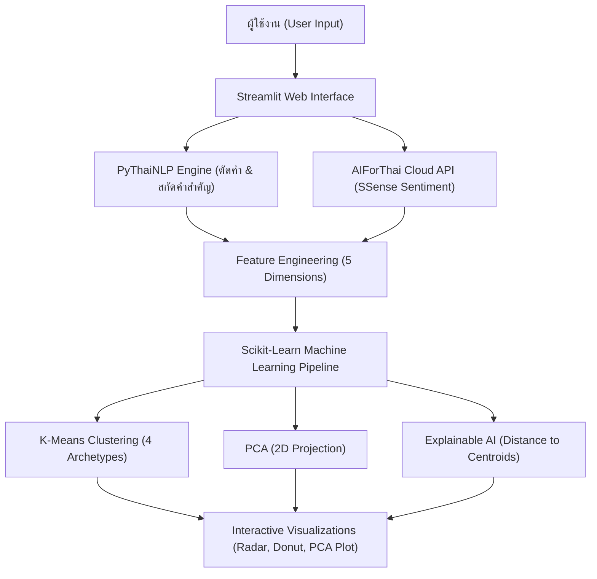

# 🧠 Personality & Team Fit Analyzer (AI & Machine Learning)

ระบบวิเคราะห์สไตล์การทำงาน บุคลิกภาพ และความเข้ากันได้ของทีมงาน ด้วย **AI NLP (AIForThai & PyThaiNLP) + Machine Learning (K-Means & PCA) + Explainable AI (XAI)**

---

## 🎯 วัตถุประสงค์และจุดเด่นของโครงการ
โปรเจกต์นี้พัฒนาขึ้นเพื่อประเมินบทบาทความถนัดในการทำงานร่วมกันในทีม ผ่านการประมวลผลข้อความภาษาไทยด้วย AI Cloud Service จาก **สวทช. (AIForThai)** ผสานกับโมเดลการเรียนรู้ของเครื่อง (Machine Learning) เพื่อจำแนกบทบาทและวิเคราะห์ความสมดุลของทีมงานอย่างเป็นวิทยาศาสตร์

- 🇹🇭 **AI Cloud Service:** เชื่อมต่อกับ **AIForThai API (SSense Sentiment Analysis)** จาก NECTEC โดยตรง
- ✂️ **Thai NLP Processing:** ประมวลผลข้อความภาษาไทยและตัดคำด้วย **PyThaiNLP Engine (newmm)**
- 🤖 **Machine Learning:** ใช้อัลกอริทึม **K-Means Clustering** เพื่อจัดกลุ่มผู้ใช้ และลดมิติข้อมูลด้วย **PCA (Principal Component Analysis)**
- 🧠 **Explainable AI (XAI):** มีระบบอธิบายเหตุผลเบื้องหลังการตัดสินใจของ AI โดยอิงจากระยะห่าง Euclidean ไปยัง Cluster Centroid
- 🖥️ **Interactive Web UI:** พัฒนาด้วย **Streamlit** มี Dashboard, Radar Chart, และ 2D PCA Cluster Map

---

## 📑 โครงสร้างของระบบ (4 แท็บการทำงาน)

### 1. 👤 ประเมินรายบุคคล & AI Explainable
- แบบประเมินสถานการณ์การทำงานจริง
- **AI Explainable Result (XAI):** แสดง Feature ที่มีอิทธิพลสูงสุด และตารางระยะห่างไปยัง Centroid ทั้ง 4 กลุ่ม
- **Personality Radar Chart:** แสดงมิติความถนัด 5 ด้าน
- **AI Advisor & Interactive Chatbot:** สรุปจุดแข็ง จุดควรระวัง และเปิดให้พิมพ์สอบถาม AI ได้แบบ Context-aware
- **Before / After Growth Tracker:** ติดตามพัฒนาการก่อน-หลังฝึกฝนทักษะ
- **Export Report:** ดาวน์โหลดรายงานสรุปผลเป็น Text (`.txt`) หรือ CSV (`.csv`)

### 2. ⚔️ เปรียบเทียบคู่หู (Side-by-Side Comparison)
- เปรียบเทียบเพื่อนร่วมงาน 2 คน พร้อมคำนวณ **Compatibility Percentage Meter**
- แสดงผลด้วย **Dual Radar Chart** ซ้อนทับ 2 สี
- วิเคราะห์ความเข้าขา (Synergy) และจุดที่ต้องระวังเวลาขัดแย้ง (Friction Points)

### 3. 👥 จัดทีม & Role Recommendation
- จำลองทีม 3–8 คน พร้อมปุ่ม Quick Presets ทดสอบสถานการณ์จริง
- คำนวณ **Team Diversity Score (0–100%)** และชาร์ต Donut แสดงสัดส่วน
- ระบบแจ้งเตือนความเสี่ยง (Critical / Redundancy Warning) เช่น การมีผู้นำซ้ำซ้อน
- **AI Team Role Recommendation:** แนะนำตำแหน่งจริงในโปรเจกต์ (Project Leader, Core Dev, Product Designer, Team Coordinator)

### 4. 📈 สรุปโมเดล ML & Feature Importance
- **Model Evaluation Metrics:** แสดงค่า Silhouette Score, Davies-Bouldin Index, และ Inertia (WCSS)
- **Feature Importance:** กราฟแท่งแสดงเปอร์เซ็นต์ความสำคัญของแต่ละตัวแปร (Random Forest)
- **2D PCA Cluster Scatter Plot:** แผนที่ 2 มิติตามระนาบ PC1 & PC2 พร้อมปักหมุดดาวสีทอง (⭐) ตำแหน่งของผู้ใช้
- **What-if Simulator:** เครื่องมือทดลองเลื่อนปรับคะแนนแบบ Real-time

---

## 🛠️ สถาปัตยกรรมระบบ (System Architecture)


---

## 💻 วิธีการติดตั้งและรันโปรเจกต์ (Installation & Usage)

### 1. โคลน Repository
```bash
git clone https://github.com/<your-username>/mini-project-ai.git
cd mini-project-ai
```

### 2. ติดตั้ง Dependencies
```bash
pip install -r requirements.txt
```

### 3. รันแอปพลิเคชัน
```bash
streamlit run app.py
```
เปิดเบราว์เซอร์ไปที่ `http://localhost:8501`

---

## 🔑 การกำหนดค่า API Key
โปรเจกต์นี้ใช้งาน Sentiment Analysis API จากแพลตฟอร์ม **AIForThai** สามารถสมัครและขอรับ API Key ได้ที่ [https://aiforthai.in.th](https://aiforthai.in.th)
และระบุในไฟล์ `app.py`:
```python
API_KEY = "YOUR_AIFORTHAI_API_KEY"
```

---

## 👥 ผู้จัดทำ (Author)
- จัดทำสำหรับ: Mini Project วิชา Artificial Intelligence
